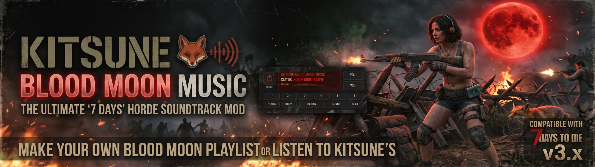

# Kitsune Blood Moon Music

A client-side [7 Days to Die](https://7daystodie.com/) mod (V3.0 "Dead Hot Summer") that plays music during the Blood Moon horde night: **Kitsune's tracks**, which come with the mod, or **your own**.

When the Blood Moon begins, the tracks play in order and the game's own music steps aside. When one finishes, the next begins; the mod loops back to the top if the night runs long. When the horde ends at dawn, the music fades out and the game's music returns.

## Install

1. Drop the `KitsuneBloodMoonMusic` folder into your game's `Mods` directory:
   - `…/steamapps/common/7 Days To Die/Mods/KitsuneBloodMoonMusic`
2. Make sure the Harmony loader (`0_TFP_Harmony`, ships with the game) is present in `Mods`.
3. Launch **without EasyAntiCheat** ("Play Not EAC") — DLL mods do not load with EAC enabled.

This is **client-side only**. It affects your own game audio, so each player installs it locally; it does not need to go on the dedicated server.

## Your own music

Put **`.ogg`**, **`.mp3`** or **`.wav`** files in your music folder, `%APPDATA%/7DaysToDie/KitsuneBloodMoonMusic/Music/` (the radio's **Settings > Open folder** takes you there while you're on your station), then press **STATIONS** on the radio to switch from Kitsune's tracks to yours. That folder is outside the mod, so updating the mod never touches your music.

Tracks play in filename order — prefix with numbers (`1_`, `2_`, … `10_`) to set the order. Numbers sort as numbers, so `2_` comes before `10_`. Other files in the folder (playlists, cover art) are ignored.

### Your playlist, your files

To pick which tracks play and in what order, put a playlist file in your music folder next to them. The songs still come from your own files: the playlist only names them.

- **Spotify:** export the playlist with Exportify and drop the `.csv` in. Or use Spotify's *Download your data* (Account → Privacy) and drop in `Playlist1.json`: the playlist named like "Blood Moon" or "Horde" plays, else the first one.
- **Other apps:** a CSV with a track name (or title) column and an artist column (TuneMyMusic, Soundiiz), or an `.m3u` / `.m3u8` list of file names.

Each song is matched to a file by name, so `Iron Nine - Remainder.mp3`, `3_Remainder.ogg` and `remainder.wav` all match "Remainder" by Iron Nine, as does "Remainder - Radio Edit". Songs in the playlist you don't have a file for are skipped and listed on the radio's settings page; files the playlist doesn't name don't play. With several playlist files, the one named `playlist` wins, else the first by name. No playlist file: every track plays, in file-name order.

Anything else converts to `.ogg` with ffmpeg:

```
ffmpeg -i "your track.flac" -vn -c:a libvorbis -q:a 5 "1_your_track.ogg"
```

Added tracks while the game is running? Press **Settings > Reload** on the radio.

## The radio

Esc menu > **Blood Moon Music**:

- **Power** plays the music now, Blood Moon or not; pressed while it plays, it fades out (during a horde, the music stays off until dawn).
- **The display** shows the status (horde night active, playing, waiting for the Blood Moon), the track, the station, the volume, and level bars that move with the music.
- **VOL +** and **VOL -**.
- **1 to 6** play that track now; **SEEK** steps back and forward through all of them.
- **STATIONS** switches between Kitsune's tracks and your own music folder.
- **SETTINGS**: how long the music **fades out at dawn** (off to 30 s), **mute the game's own music while yours plays** (on by default), **Reload** the station's folder after adding or removing tracks or a playlist, **Open folder**, and the station's tracks in play order with any playlist songs that have no file.

Settings are saved per player in `%APPDATA%/7DaysToDie/KitsuneBloodMoonMusic/settings.txt`.

The same things from the console (F1): `bmmusic` for what the mod sees, `bmmusic play` (on/off), `bmmusic next`, `bmmusic station`, `bmmusic reload`. The game's log (`%APPDATA%/7DaysToDie/logs`) shows `[BloodMoonMusic] Blood Moon: music on` when the horde starts, each track as it plays, and `music off` after the dawn fade.

## Troubleshooting

**The music plays on your speakers, not your headset.** The music goes to Windows' **default playback device**, not the default *communication* device (that one is for voice chat apps like Discord). USB headsets often end up as only the communication device. Right-click the speaker icon > **Sound settings** > **More sound settings**, select your headset on the **Playback** tab, and press **Set Default** (the button itself, not just its *Default Communication Device* option). Restart the game afterwards.

## How it works

An `IModApi` mod that checks `World.IsWorldEvent(WorldEvent.BloodMoon)` once per second, driving a `DontDestroyOnLoad` `AudioSource`. That flag comes from the world clock and the horde day, so it is set on a client of a server too (the AI director's own Blood Moon flag only exists where the world is hosted). Clips are loaded at startup, sorted by name, via `UnityWebRequestMultimedia.GetAudioClip`.

## Build

Requires the .NET SDK. The project references the game's own `Managed` assemblies (it targets the Unity/Mono **net48** profile — `Assembly-CSharp` has an indirect .NET 4.8 dependency, so `IModApi`/`Mod` only import cleanly at net48).

```
dotnet build -c Release
# or point at your install:
dotnet build -c Release -p:GameManaged="D:/path/to/7DaysToDie_Data/Managed"
```

The built `KitsuneBloodMoonMusic.dll` goes in the `KitsuneBloodMoonMusic/` mod folder next to `ModInfo.xml`; commit it with the source change.

No game install? The build falls back to `refs/`: stripped reference assemblies with the game's API and none of its code, made by JetBrains Refasmer. Regenerate them from a **client** install (the dedicated server's `Assembly-CSharp` leaves out the UI types) when the game updates or you add a reference:

```
dotnet tool install --global JetBrains.Refasmer.CliTool
bash tools/strip-refs.sh "D:/path/to/7 Days To Die"
```

The SDK is pinned in `global.json` (8.0.421). CI (`.github/workflows/build.yml`) builds against `refs/` on every PR and push to `main`, checks the committed DLL is byte-for-byte what the source builds to, and checks the mod's XML parses.

## Credits

Bundled music is original work by **AdaInTheLab** (Iron Nine / Kitsune Den). Mod by AdaInTheLab. The music is the author's own and shared with the mod.

## License

[CC BY-NC-SA 4.0](LICENSE), with an extra permission for servers that make money: see [NOTICE.md](NOTICE.md). In short: play it, change it and share it, with credit, not for sale, and with changed versions under the same license.
